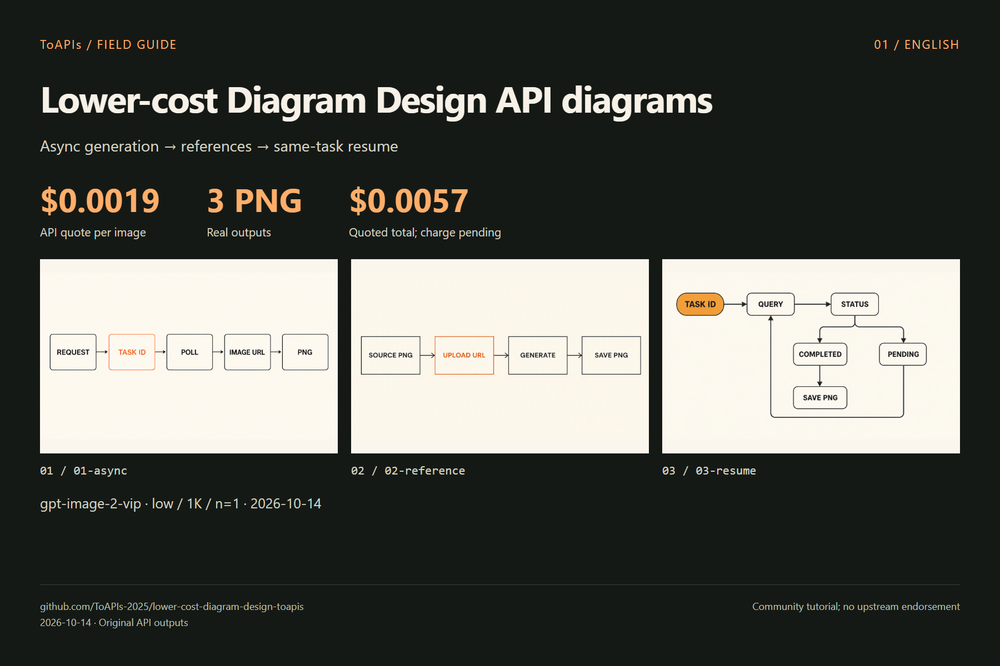
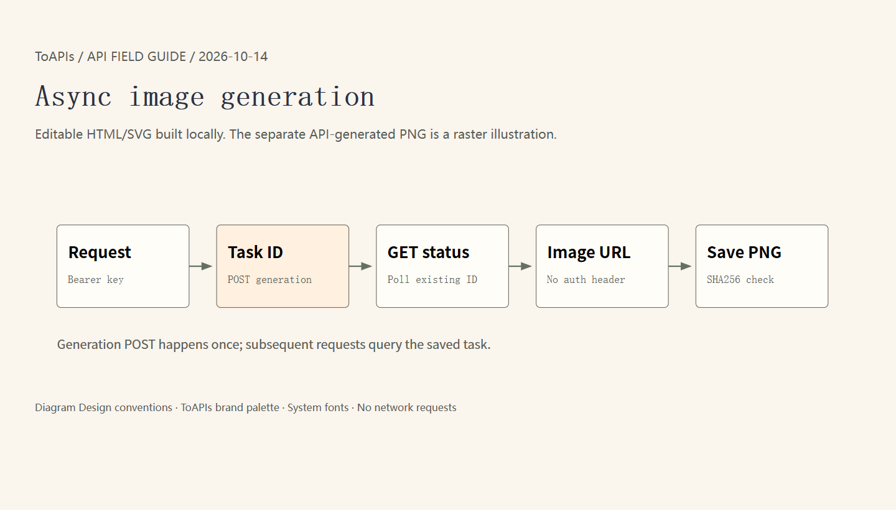

# Lower-cost Diagram Design API diagrams

[中文](README_zh-CN.md)

ToAPIs `gpt-image-2-vip / low / 1K / n=1` for Diagram Design workflows. 3 completed images, **$0.0057 quoted total**; actual charge pending account reconciliation.

Local editable HTML/SVG API diagrams plus independently tested ToAPIs PNG illustrations. PNGs are model outputs; HTML/SVG is authored in code. Agent-host execution was not validated.

> Community tutorial; no upstream endorsement. “Lower-cost” describes this API tier, not total software or all-model costs.

## Demo



| Case | Original image | Output pixels |
|---|---|---|
| 01-async | [PNG](assets/01-async.png) | 1536 × 864 |
| 02-reference | [PNG](assets/02-reference.png) | 1536 × 864 |
| 03-resume | [PNG](assets/03-resume.png) | 1536 × 864 |

Three [editable HTML/SVG diagrams](diagrams/) are locally authored with no additional model calls. The PNGs above are independent image API outputs; retain their original text quality for comparison.



[Editable HTML](diagrams/01-async.html) · [Editable SVG](diagrams/01-async.svg)

## Model price and this demo’s cost

| Model | Configuration | API unit quote |
|---|---|---|
| `gpt-image-2-vip` | `low / 1K / n=1` | **$0.0019** |

3 completed images, **$0.0057 quoted total**; actual charge pending account reconciliation。

[API pricing snapshot](evidence/pricing.json) · [Cost record](evidence/costs.json) · [Original requests](evidence/runs.json)

Quote checked on 2026-10-14. Other tiers, resolutions, models, agents and machine costs are excluded.

[ToAPIs model landing page](https://go2v.toapis.com/1014_diagram_lowercost_gh_en)

## Reproduce

Set `TOAPIS_API_KEY` privately in your local environment. Keep it out of source code and chats. Use `TOAPIS_BASE_URL=https://toapis.cn` or `https://toapis.com`.


```bash
# Inspect without paid calls
python scripts/run_demo.py
# Generate the original cases (charged; exact quote checked first)
python scripts/run_demo.py --live --output results
```

The generic script is an external asset runner. Original PPT Master CLI runs are separately identified in the evidence.

## API mapping

```text
Authorization: Bearer TOAPIS_API_KEY
POST /v1/uploads/images             # reference PNG -> HTTPS URL
POST /v1/images/generations         # model,prompt,size,resolution,quality,n,reference_images
GET  /v1/images/generations/{id}    # poll the SAME task
completed -> result.data[0].url -> download PNG without the API key
```

Generation POST is never automatically retried. Preserve .toapis-state or results/private-state to resume the same task. Reference editing is not masked inpainting. Masks, transparency, audio and cloud video were not tested.

## Upstream and licenses

[cathrynlavery/diagram-design](https://github.com/cathrynlavery/diagram-design) · [pinned `11b08ead`](https://github.com/cathrynlavery/diagram-design/tree/11b08eade8049c441ed3df1895e3b527c26c0fbe)

[Third-party notices](THIRD_PARTY_NOTICES.md)
